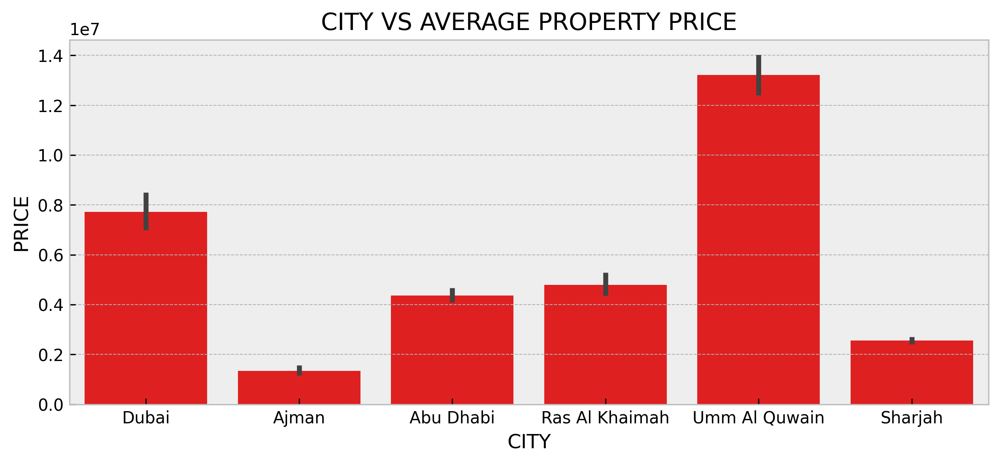
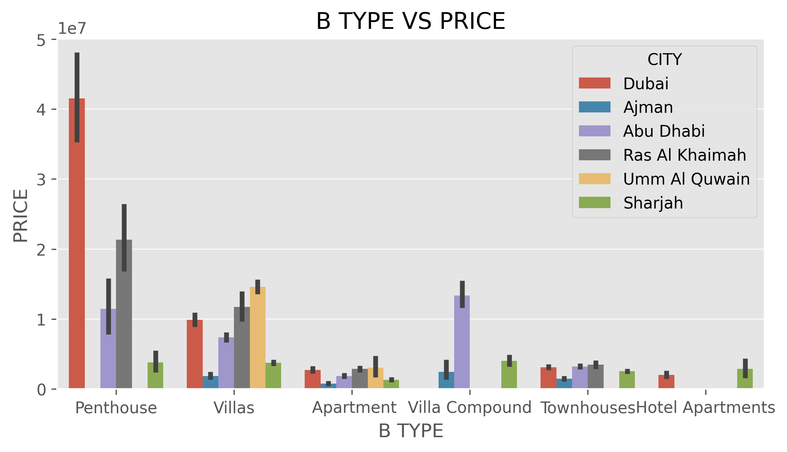
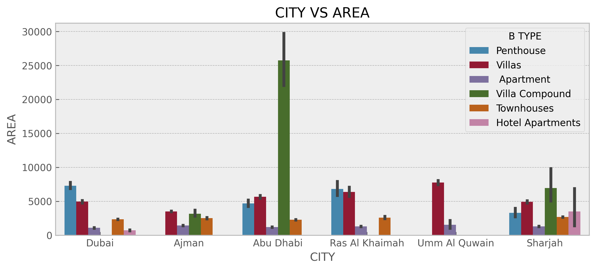
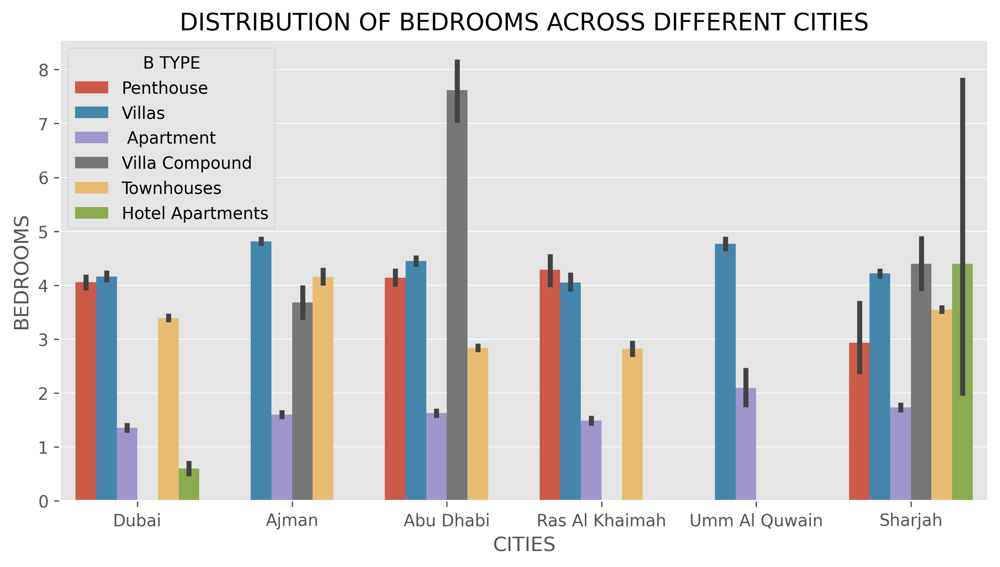
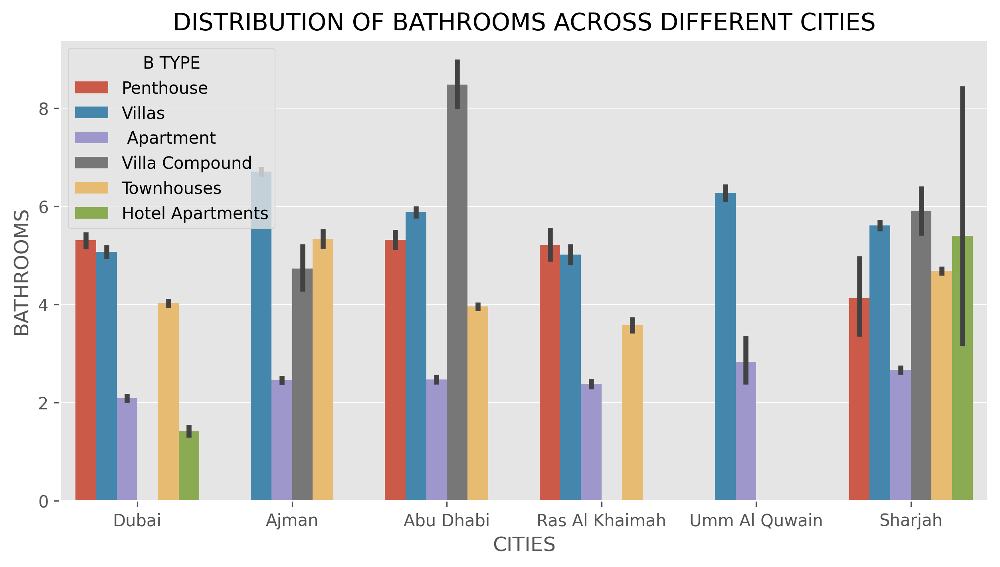
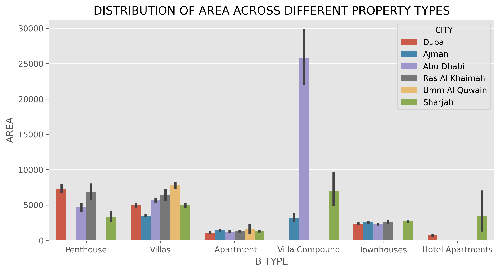
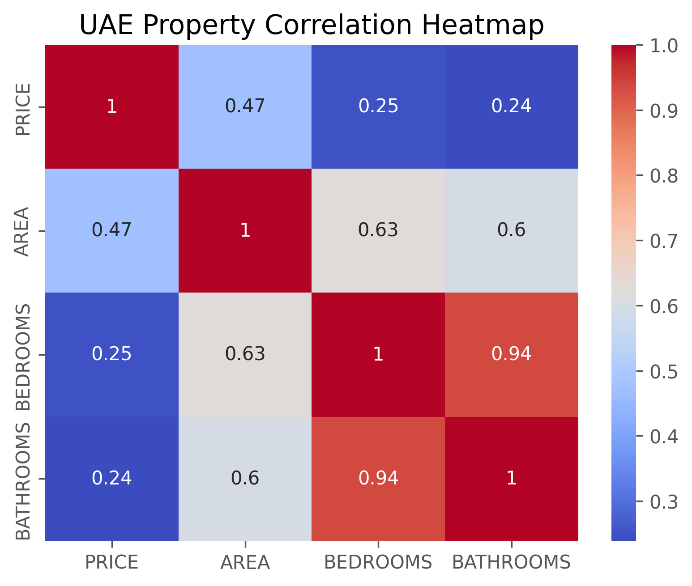
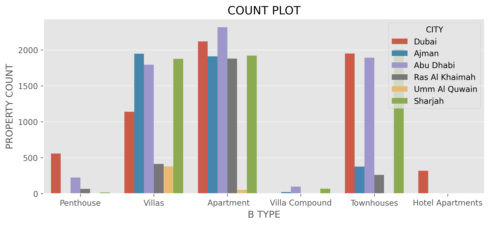
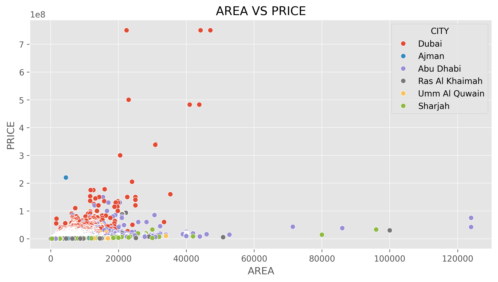

# UAE House Price Analysis

## About the Project

I created this project to explore the real estate market across different cities and districts in the UAE. The main goal was to understand how property prices vary based on location, property type, area, bedrooms, and bathrooms.

Using Python, I performed Exploratory Data Analysis (EDA) to identify pricing patterns, compare property categories, and understand differences across the UAE property market.

## Dataset Information

The dataset contains UAE property listings with information about:

- Property Name
- City
- District
- Property Type
- Property Price
- Area
- Bedrooms
- Bathrooms

## Tools & Technologies

- Python
- Pandas
- Matplotlib
- Seaborn
- Jupyter Notebook

## Data Cleaning & Preparation

Before starting the analysis, I performed the following steps:

- Loaded the dataset using Pandas.
- Checked the first and last records.
- Examined missing values and column information.
- Cleaned column names by removing extra spaces and standardizing the format.
- Removed duplicate records.
- Converted Area and Price columns into numeric formats.
- Checked the dataset structure and data types.

## Exploratory Data Analysis

I explored the dataset through 24 questions covering different aspects of the UAE real estate market.

**Property Price Analysis**
- Identified the cheapest and most expensive properties.
- Compared prices across different property types.
- Analyzed bedroom-wise and bathroom-wise average property prices.

**City & District Analysis**
- Compared average property prices across cities.
- Identified the highest and lowest average property areas.
- Analyzed the cheapest and most expensive districts.
- Identified the top 10 expensive and cheapest districts.
- Compared the top 3 expensive and cheapest cities.

**Property Features Analysis**
- Studied the relationship between property area and price.
- Compared bedroom and bathroom distributions.
- Analyzed average area across different property types and cities.
- Examined property classification and its impact on pricing.

**Additional Analysis**
- Compared property prices across different property classifications.
- Analyzed property counts by type and city.
- Identified the top 3 expensive and cheapest property types.
- Created a correlation heatmap to understand relationships between numerical features.

## Project Visualisations & Analysis

### 1. City-wise Average Property Price

This chart compares the average property prices across different cities in the UAE. It helps identify which cities have higher property prices and which cities are relatively more affordable.

### 2. Property Type vs Price

This chart compares property prices across different property types in various cities. It helps understand how property categories influence pricing and how prices vary between cities.

### 3. City-wise Average Property Area

This chart compares the average property area across different cities and property types. It helps identify differences in property sizes across the UAE real estate market.

### 4. Bedroom Distribution Across Cities

This chart compares bedroom distribution across different cities and property types. It helps understand how the number of bedrooms varies between locations and property categories.

### 5. Bathroom Distribution Across Cities

This chart compares bathroom distribution across different cities and property types. It provides an overview of how bathroom counts differ across property categories and locations.

### 6. Property Area Distribution

This chart compares property area across different property types and cities. It helps identify variations in property sizes and understand the distribution of available properties.

### 7. Correlation Heatmap

This heatmap shows the correlation between numerical features such as property price, area, bedrooms, and bathrooms. It helps identify positive and negative relationships between these variables.

### 8. Property Count by Type and City

This chart compares the number of property listings across different property types and cities. It helps identify which property categories have more listings in different locations.

### 9. Area vs Price Scatter Plot

This scatter plot compares property area with property price across different cities. It helps understand how property prices change with property size and identify pricing patterns across locations.

## Key Learnings

Through this project, I improved my understanding of:

- Data cleaning and preprocessing using Pandas.
- GroupBy operations and statistical analysis.
- Mean, median, minimum, and maximum calculations.
- Comparing property prices across cities and districts.
- Working with different property features.
- Creating meaningful visualizations using Matplotlib and Seaborn.
- Performing Exploratory Data Analysis on real-world datasets.

## Conclusion

This project helped me explore different factors affecting property prices across the UAE. By comparing cities, districts, property types, and property features, I gained a better understanding of real estate market trends and strengthened my practical data analysis skills using Python.
